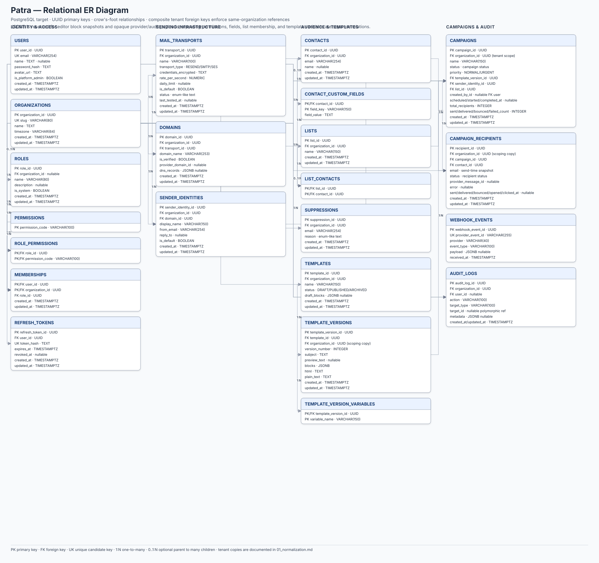

# Patra · Database Management Systems Project

Patra is a multi-tenant email campaign application where organizations manage audiences, publish templates, configure senders, and track delivery. This course project translates Patra's MongoDB/Mongoose data model into a PostgreSQL schema and uses it to demonstrate normalization, relational integrity, and query performance.

**Team T0066** · Sarthak Gupta (lead), Shresth Juyal, Yuvansh Juneja, and Yashaswi Gusain

## Normalization and design

| Topic | How the PostgreSQL design applies it |
| --- | --- |
| **1NF · Repeating groups** | Move role permissions, contact custom fields, list membership, and template variables into keyed child or junction tables. For example, `list_contacts` stores one row per list and contact pair. |
| **2NF · Partial dependencies** | In `contact_custom_fields`, the field value depends on both `contact_id` and `field_key`. The report documents the exception in `template_versions`, where `template_id` alone determines the copied `organization_id`. |
| **3NF · Transitive dependencies** | A sender identity gets its mail transport through its domain. Removing the sender-level transport field avoids stale references when a domain changes transport. The report also covers retained tenant IDs and BCNF exceptions. |

The schema maps MongoDB ObjectIds to UUIDs. Primary keys, foreign keys, unique constraints, and checks enforce relational integrity. Composite foreign keys make sure a campaign's list, sender identity, and template version belong to the same organization as the campaign.

The design keeps some duplication to serve specific reads. Campaign counters support dashboard summaries, and recipient email addresses preserve the address used for a send even if the contact changes it later. Template editor blocks, webhook payloads, and audit metadata are stored as JSON snapshots.

## Entity relationships

A campaign ties together a mailing list, a sender identity, and a specific published template version. List and contact membership is many-to-many. Each campaign has recipient rows for tracking send and delivery state.

## Course deliverables

| Checkpoint | Files |
| --- | --- |
| **CP1 · Normalization** | [Normalization report](dbms/01_normalization.md) with candidate keys, functional dependencies, and denormalization trade-offs |
| **CP2 · Relational design** | [ER diagram source](dbms/02_er_diagram.mmd), [PNG export](dbms/02_er_diagram.png), and [PostgreSQL schema](dbms/03_schema.sql) for 22 tables |
| **CP3 · SQL workload** | [68 queries](dbms/04_queries.sql) covering authentication, organization roles, audiences, templates, campaign delivery, and reporting |
| **CP4 · Benchmark** | [Synthetic seed data](dbms/seed.sql), [benchmark runner](dbms/run_benchmark.py), [baseline timings](dbms/05_query_timings.md), and [execution plans](dbms/plans/) |

## Benchmark and demo

The benchmark runs 32 read and 36 write queries three times each with `EXPLAIN (ANALYZE, BUFFERS, TIMING ON)`. It rolls back every write after measuring it, so later queries can use the same seeded data. Running the benchmark replaces the timing report and individual plan files. The checked-in baseline records PostgreSQL 15.19 and 203,450 synthetic rows. It uses the indexes backed by primary-key and unique constraints.

- **R7** follows an organization membership through its role to the assigned permissions, showing how the schema represents a repeating set.
- **W27** builds a campaign audience from a list while excluding suppressed addresses. Its [execution plan](dbms/plans/W27.txt) shows the work behind audience selection and recipient insertion.
- **R31** reads recent activity for a campaign's recipients, showing how delivery history supports reporting.
